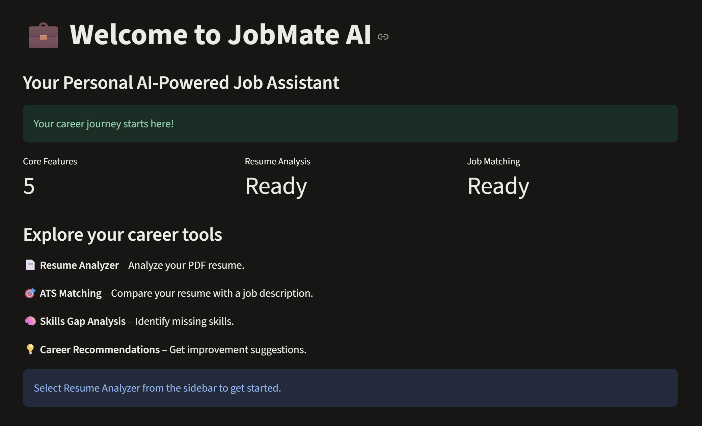
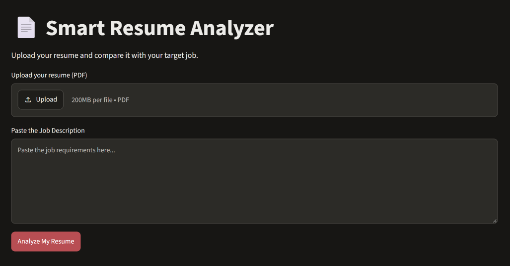
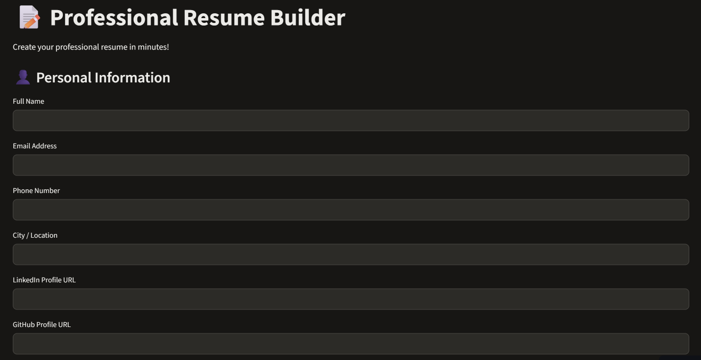
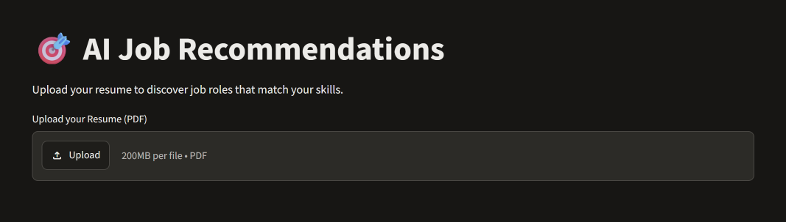

# 💼 JobMate AI
🌐 **Live Demo:** [JobMate AI](https://jobmate-ai-abhishek.streamlit.app)

💻 **GitHub Repository:** [JobMate AI](https://github.com/abhishekpal8146/JobMate-AI)

**An AI-powered Resume Analyzer and Career Assistant built with Python and Streamlit.**

JobMate AI helps job seekers analyze their resumes, identify skill gaps, improve ATS compatibility, build professional resumes, and explore suitable career opportunities.

## 🚀 Features

- 📄 **Resume Analyzer** – Upload and analyze PDF resumes.
- 📊 **ATS Score Analysis** – Calculate resume match scores against job descriptions.
- 🎯 **Skill Gap Analysis** – Identify matched and missing skills.
- 💡 **Personalized Suggestions** – Get recommendations to improve your resume.
- 🗺️ **Learning Roadmap** – Discover skills to work on next.
- 📝 **Resume Builder** – Create and download professional PDF resumes.
- 💼 **Job Recommendations** – Find job roles based on detected resume skills.
- 📥 **PDF Reports** – Download resume analysis reports.

## 🛠️ Tech Stack

- Python
- Streamlit
- Pandas
- NumPy
- PyPDF
- ReportLab

## ⚙️ Installation and Setup

1. **Clone the repository:**

   ```bash
   git clone https://github.com/abhishekpal8146/JobMate-AI.git
   ```

2. **Navigate the project directory:**

   ```bash
   cd JobMate-AI
   ```

3. **Create a virtual environment:**

   ```bash
   python -m venv venv
   ```

4. **Activate the virtual environment (Windows):**

   ```bash
   venv\Scripts\activate
   ```

5. **Install dependencies:**

   ```bash
   pip install -r requirements.txt
   ```

6. **Run the application:**

   ```bash
   streamlit run app.py
   ```
   
## 📂 Project Structure

```text
JobMate-AI/
│
├── app.py
├── requirements.txt
├── README.md
├── .gitignore
```

## 📸 Project Screenshots

### Dashboard


### Resume Analyzer


### Resume Builder


### Job Recommendations


## 📌 Important Note

Job recommendations and ATS matching are based on keyword and skill matching. The scores are estimates and do not guarantee job eligibility or selection.

## 👨‍💻 Author

Developed as a career-assistance project for job seekers.

## 📜 License

License information will be added soon.
